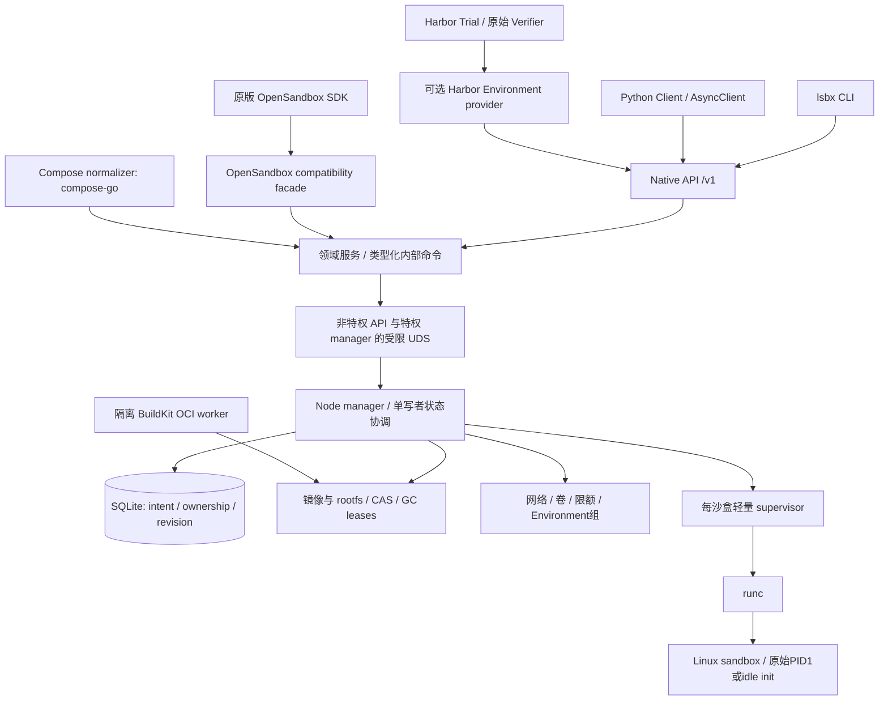

# 架构：接口门面、环境服务与执行监督

## 部署结构

**核心不含 Trial、Agent、Evaluator、Reward、PoC 等领域类型。** 这些词可以出现在外部验收目录，不能进入运行时依赖图。Environment只是services、networks、volumes等物理执行资源组合。HarborRecipe描述任务侧信息，两者分离。

## 模块与依赖方向

| 模块/包 | 负责 | 禁止 |
|---|---|---|
| `ls-core` | 类型、状态机、配额算术、能力判定、领域命令 | HTTP、SQL、特权syscall、Harbor导入 |
| `ls-host` | 应用服务、状态持久化、runc、镜像、网络/卷、恢复；包含supervisor二进制 | 直接解释OpenSandbox字段或任务奖励 |
| `ls-api` | native/compat两门面、鉴权、参数/错误映射、限流、代理端点 | mount、任意宿主路径和任意root shell |
| `ls-guest` | idle init、按需文件助手、受限guest辅助操作 | 常驻HTTP服务、调度器、DB、模型SDK |
| `lightsandbox` | 原生Python客户端/异步客户端及CLI用户接口 | 本地直接runc执行；把用户任务当插件加载 |
| `lightsandbox_harbor` | 固定BaseEnvironment接口、格式到领域请求的编译 | 重写Harbor Trial/Verifier/奖励，调用用户指定backend factory |
| `ls-compose` | 用compose-go生成版本化规范化IR | 特权编排、访问宿主秘密、执行任意remote include |

先保持四个Rust crate；trait按职责定义，不为未来多后端预先创建空实现。`OciRuntime`只有`RuncRuntime`生产实现。参考Docker/OpenSandbox由测试适配器调用，不参与运行时选择。

## 进程和权限

`lightsandboxd api`作为非特权服务，默认由operator部署；`lightsandboxd manager`拥有其所需权限且只监听固定UDS；`lightsandboxd supervise --sandbox-id <opaque>`由manager派生。UDS权限与SO_PEERCRED校验并行，所有权从受信身份建立，拒绝客户端任意owner字段。

supervisor首发按sandbox划分：拥有PTY master、管道、子进程监督及顺序化退出收据。它无公开HTTP监听、不加载Harbor或Python。存储目录由manager创建并授予最小访问权限。manager为SQLite唯一写者；supervisor写私有追加日志/原子收据，再由manager归并，避免多个进程自由写同一DB。

manager/API重启不终止存活supervisor。supervisor丢失会使该沙盒需要隔离与对账，不重新发起旧命令；不会声称整个worker任意进程故障都可无损恢复。单位沙盒监督有固定成本，先测PSS/RSS和运行数量。只有数据证明监督开销是瓶颈，才开发分片共享supervisor并比较故障影响。

## 构建、准备和运行分开

1. `env plan`读取已授权的输入，产生可审阅计划；不执行Dockerfile。
2. `templates:prepare`使用构建预算，解析标签为digest、构建/拉取镜像，生成不可变ResolvedTemplate。
3. `environments.create`验证模板来源、宿主能力和运行预算，创建卷/网络/sandbox。
4. `executions.start`向现有sandbox提交命令，使用明确的exec identity和输出预算。
5. `delete`撤销入口和写权限、终止进程、回收网络/挂载/卷引用，确认后释放配额。

构建占用构建池，不能长时间预占全部活跃sandbox容量。离线镜像导入也必须验摘要和平台。模板已准备不表示目标host一定支持它；准入仍需再次检查。

## 数据持久化边界

SQLite保存意图、对象归属、请求去重、状态修订及引用关系。OCI内容和输出大文件存在文件存储，不能逐输出chunk同步写SQLite。管理操作采用intent→effect→receipt→state，恢复器依据实际资源对账，不跨await持数据库事务。

对象目录只使用服务器生成的ID；外部名称作为元数据。CAS按digest去重但读权限和租约按owner控制，不能因知道哈希就读到其他调用方资产。GC只处理无活动引用且经过保留期的对象，含prepare/build/export中的引用。

## 默认边界

共享宿主内核容器不能保证抵御任意内核漏洞。危险负载放在专用worker VM，管理网络与模型凭据网关隔离。用户提供root命令或Dockerfile并不授予宿主root管理权限。首次兼容只保证批准的host profile。[S01/S02/S04]

首发准入按 `HostCapabilityTier=PORTABLE_ROOTLESS` 验证：单 ID userns、无 subuid/uidmap helper、无 cgroup 委托、无 /dev/fuse、无可写私有 proc 保证。FULL_ROOTLESS 与 ROOTFUL 是显式的独立支持配置，不是 PORTABLE_ROOTLESS 的隐含回退或假设；逐能力状态与证据按 T03 HostReport 登记（见领域合同 §宿主能力分层）。
